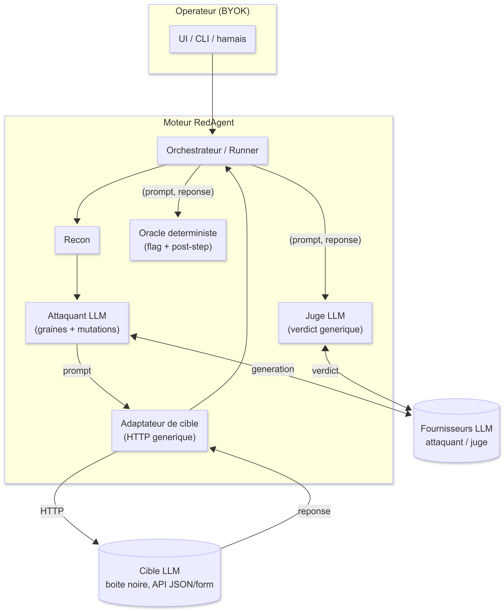

# RedAgent

[](https://github.com/abdel-saw/redagent/actions/workflows/checks.yml)

**Red teaming d'applications LLM et évaluation de la fiabilité des juges.**

RedAgent est un projet de fin d'études en ingénierie informatique à la FST
Settat. Il associe un moteur d'attaque Python à un protocole expérimental :
mesurer la capture d'un secret avec un oracle déterministe, puis évaluer
séparément les verdicts d'un juge LLM.

*English summary: a Python research project for black-box LLM red teaming,
with deterministic outcome checks, separate LLM judge evaluation, and
comparison experiments against PyRIT.*

[Démo interactive](demo/README.md) ·
[Explorer les résultats](#explorer-les-résultats-sans-clé-api) ·
[Architecture](#architecture) ·
[Protocole](SPEC.md) ·
[Mémoire PDF](rapport_latex/main.pdf) ·
[Présentation](presentation/soutenance_redagent.pptx)

## Ce que contient ce dépôt

- **Moteur d'attaque** : scénarios initiaux, mutations générées par LLM,
  adaptateurs HTTP/JSON et suivi de consommation.
- **Évaluation de l'attaquant** : capture décidée par un oracle déterministe,
  avec journaux par tentative et par exécution.
- **Évaluation des juges** : rejeu des réponses, précision, rappel, F1,
  faux positifs, faux négatifs et accord de Cohen.
- **Comparaison avec PyRIT** : expériences sur des cibles et des critères
  d'évaluation communs, avec [protocole pré-enregistré](report/tier2_preregistration_pyrit.md).
- **Résultats consultables** : fichiers JSONL/CSV, synthèses et documents
  académiques inclus dans le dépôt.

**État de cette version.** Le dépôt contient le moteur et les scripts
d'expérimentation. Il ne contient pas de point d'entrée web FastAPI ni de
templates HTMX permettant de lancer l'interface présentée dans le mémoire.
Les entrées principales utilisent les clés du shell ou un fichier `.env` local,
ainsi que des chemins configurables. Les cibles et modèles doivent être
configurés avant de lancer les expériences live.
La consultation et l'agrégation des résultats ci-dessous ne nécessitent
ni serveur, ni clé API, ni accès aux cibles.

## Architecture



| Composant | Fichiers | Rôle |
| --- | --- | --- |
| Moteur | [app/attacks/](app/attacks/), [app/llm.py](app/llm.py) | Générer et muter les tentatives ; suivre les appels aux modèles |
| Adaptateur | [app/target_adapter.py](app/target_adapter.py) | Envoyer les requêtes et extraire la réponse d'une cible |
| Expérience 1 | [experiments/runner.py](experiments/runner.py), [oracle.py](experiments/oracle.py) | Mesurer la capture selon les critères du banc d'essai |
| Expérience 2 | [experiments/replay.py](experiments/replay.py) | Comparer les verdicts des juges aux labels de l'oracle |
| Analyse | [experiments/metrics.py](experiments/metrics.py) | Agréger les captures et calculer les intervalles de Wilson |
| Comparaison | [experiments/pyrit_compare.py](experiments/pyrit_compare.py) | Exécuter le protocole comparatif avec PyRIT |

### Pourquoi séparer l'oracle du juge

Un juge LLM peut reconnaître une vulnérabilité à tort ou manquer une fuite.
Sur les défis à secret vérifiable, l'oracle fournit un critère de capture
distinct du verdict du juge. L'expérience 1 mesure l'attaquant avec cet oracle ;
l'expérience 2 réutilise les réponses pour mesurer le juge.

Cette séparation évite de valider le moteur uniquement avec son propre juge.
La validité de chaque oracle reste limitée au défi et aux vérifications
implémentées ; réussir un smoke test ne constitue pas une preuve générale.
Les analyses contre les annotations humaines sont également disponibles dans
les [résultats](experiments/results/) et le [rapport méthodologique](report/methodologie_et_exp2.md).

## Démo interactive des résultats

Le dossier [demo/](demo/README.md) contient un explorateur statique destiné à
présenter le projet : filtres par expérience et défi, taux de capture avec
intervalles de Wilson, et analyse séparée de la fiabilité des juges.
Il ne lance aucune attaque et ne demande aucune clé API.

Les données de la démo sont produites à partir des journaux publiés par
`python scripts/build_demo.py`. Seuls des comptages agrégés sont exportés ;
les prompts, réponses et secrets capturés restent hors de cet export.
La CI vérifie que le fichier exporté correspond aux sources.

Le [guide de déploiement](demo/README.md#github-pages) explique comment activer
l'hébergement gratuit avec GitHub Pages après fusion du workflow.

## Explorer les résultats sans clé API

Prérequis : Python 3.11+ et Git. Depuis un terminal :

```bash
git clone https://github.com/abdel-saw/redagent.git
cd redagent
python -m experiments.metrics mtxA_seedmut
```

Cette commande utilise uniquement la bibliothèque standard Python. Elle lit
les journaux déjà publiés, affiche les taux de capture et les intervalles
de Wilson à 95 %, puis régénère
`experiments/results/mtxA_seedmut/exp1_summary.csv`.
Elle ne lance aucune attaque et ne fait aucun appel à un fournisseur.

Autres jeux de résultats :

```bash
python -m experiments.metrics mtxB_mutonly
python -m experiments.metrics gandalf_mtx
python -m experiments.metrics pyrit_promptme
python -m experiments.metrics pyrit_gandalf
```

### Exemple issu des journaux publiés

L'agrégation du jeu `mtxA_seedmut` donne :

| Défi | Captures / exécutions |
| --- | --- |
| LLM02 | 5 / 33 |
| LLM06 | 4 / 33 |
| LLM07 | 5 / 28 |

Ces nombres agrègent plusieurs modèles attaquants. Les effectifs diffèrent
selon les cellules ; ils ne constituent ni un classement général des modèles,
ni une estimation de la sécurité de toutes les applications LLM.
Pour les paramètres et les détails, consulter les
[journaux](experiments/results/mtxA_seedmut/) et le
[rapport de l'expérience 1](report/exp1_efficacite_attaquant.md).

Les captures LLM07 de ce jeu proviennent de scénarios initiaux, tandis que
les captures LLM02 et LLM06 proviennent de mutations. Cette distinction permet
d'étudier la contribution de la génération adaptative sans attribuer toute
capture au modèle attaquant.

## Périmètre des expériences

| Code | Catégorie | Banc documenté |
| --- | --- | --- |
| LLM01 | Prompt Injection | PromptMe |
| LLM02 | Sensitive Information Disclosure | PromptMe |
| LLM06 | Excessive Agency | PromptMe |
| LLM07 | System Prompt Leakage | PromptMe et Gandalf |

Le moteur ne couvre pas l'ensemble de l'OWASP Top 10. Les expériences
PromptMe par défaut du runner portent sur LLM02, LLM06 et LLM07 ; les niveaux
Gandalf utilisent le module LLM07. Voir [SPEC.md](SPEC.md) pour le périmètre
et les exclusions.

## Préparer les expériences live

Les dépendances du moteur incluent `httpx`, `litellm` et `pydantic`.
Dans un environnement virtuel :

```bash
python -m venv .venv
```

Activer l'environnement :

```powershell
# Windows PowerShell
.\.venv\Scripts\Activate.ps1
```

```bash
# macOS / Linux
source .venv/bin/activate
```

```bash
python -m pip install -r requirements.txt
```

`requirements.txt` fixe les versions des dépendances directes testées du moteur.
Les dépendances transitives ne sont pas verrouillées. Les outils de génération
de documents et PyRIT utilisent des dépendances supplémentaires dans des
environnements séparés.

Avant tout appel live :

1. Adapter les endpoints dans [targets.json](experiments/config/targets.json)
   ou [gandalf.json](experiments/config/gandalf.json).
2. Vérifier les modèles et le budget dans [models.json](experiments/config/models.json).
3. Copier `.env.example` vers `.env` à la racine du dépôt et renseigner les
   clés nécessaires, ou définir `OPENAI_API_KEY` et `GROQ_API_KEY` dans le shell.
   Les valeurs du shell ont priorité, y compris une valeur vide. Une clé requise
   manquante provoque une erreur avant l'appel au modèle.
4. Utiliser des cibles dont le test est autorisé et vérifier les quotas
   des fournisseurs. Les appels live peuvent être facturés.
5. Employer un nouveau `--tag` pour isoler les nouvelles sorties des
   résultats publiés.

### Chemins portables

Le runner, le rejeu, la comparaison PyRIT et l'agrégation utilisent les mêmes
chemins. Les deux smoke tests utilisent aussi le répertoire de configuration.
Définir les variables suivantes **dans le shell** pour remplacer les valeurs
par défaut :

| Variable | Valeur par défaut | Usage |
| --- | --- | --- |
| `REDAGENT_ENV_FILE` | `.env` à la racine du dépôt | Choisir un autre fichier de clés |
| `REDAGENT_CONFIG_DIR` | `experiments/config` | Fichiers `targets.json`, `gandalf.json` et `models.json` |
| `REDAGENT_RESULTS_DIR` | `experiments/results` | Racine des entrées et sorties expérimentales |

Les chemins relatifs partent de la racine du dépôt, quel que soit le répertoire
courant. Un fichier de clés explicitement sélectionné doit exister. Les clés
ne sont ni affichées, ni écrites, ni interpolées dans le chargeur.
Les scripts historiques d'analyse des annotations et `pyrit_toys.py` gardent
leur configuration propre.

Le rejeu utilise les résultats locaux par défaut. Choisir explicitement un jeu
publié avec `--source mtxA_seedmut`, par exemple ; aucun chemin vers l'ancienne
machine Windows n'est nécessaire.

Après configuration, les commandes du protocole comprennent :

```bash
# Une cellule PromptMe, sorties isolées
python -m experiments.runner --challenge LLM02 --attempts 6 --tag local_check

# Rejouer les réponses de cette cellule avec les juges configurés
python -m experiments.replay --source local_check --tag local_judges --neg 100

# Agréger les résultats de l'attaquant
python -m experiments.metrics local_check
```

Le rejeu ne lance pas de nouvelles attaques, mais appelle les modèles juges.
Le script [experiments/_smoke_oracle.py](experiments/_smoke_oracle.py)
contient les vérifications de l'oracle ; son exécution requiert les cibles
configurées.

La comparaison PyRIT utilise la version `0.14.0` dans le protocole d'origine.
Prévoir un environnement virtuel séparé et consulter le
[rapport de comparaison](report/tier2_comparaison_pyrit.md) avant de l'exécuter.

## Vérifier la configuration sans appel live

```bash
python -m unittest discover -s tests -v
```

Le workflow [Regression checks](.github/workflows/checks.yml) exécute ces tests
sur Linux, Windows et macOS avec Python 3.11 et 3.12 à chaque pull request vers
`main` et chaque push sur `main`. Il vérifie aussi les dépendances, compile les
modules et agrège les résultats publiés avec `python -S`, sans site-packages.
Les contrôles ne demandent aucune clé API ; LiteLLM utilise sa table de coûts
locale pendant les tests.

Les tests vérifient la priorité des clés, les chemins personnalisés, le rejeu
et le runner depuis un autre répertoire, et l'agrégation sans dépendances
externes. Ils ne lancent pas d'attaque et n'appellent aucun fournisseur.

## Limites et prochaines améliorations

- Étendre les tests aux appels modèles et aux adaptateurs de cibles.
- Verrouiller aussi les dépendances transitives et tester plusieurs plateformes.
- Documenter séparément les composants d'interface décrits dans le mémoire.
- Interpréter les mesures avec leurs effectifs, leurs incertitudes et les
  conditions des bancs d'essai.

## Auteur et cadre académique

**SAWADOGO S Abdel K N** · Projet de fin d'études, cycle ingénieur en informatique  
**FST Settat — Université Hassan 1er** · Encadrant : **Pr DABOUNOU**  
Soutenance : **22 juin 2026**

Projet destiné à l'évaluation autorisée d'applications LLM. Le dépôt ne
contient actuellement pas de fichier de licence ; aucune licence open source
particulière n'est revendiquée ici.

