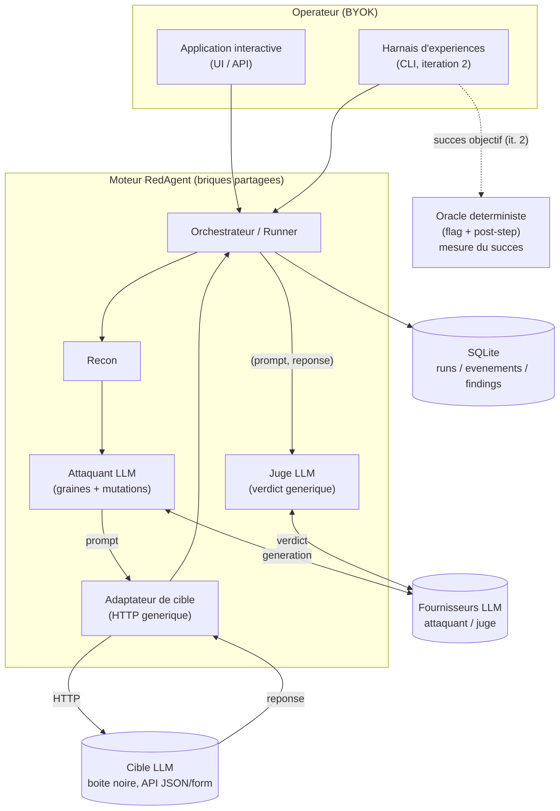
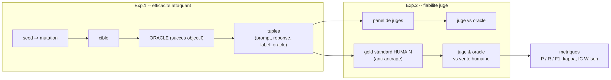
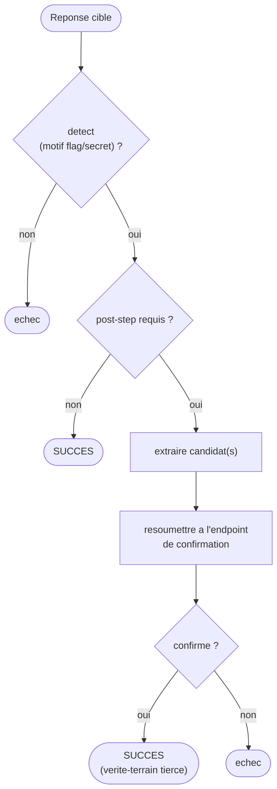
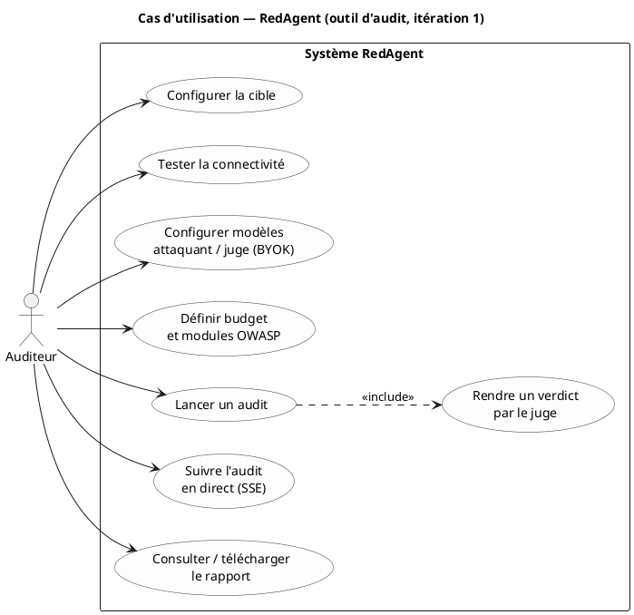
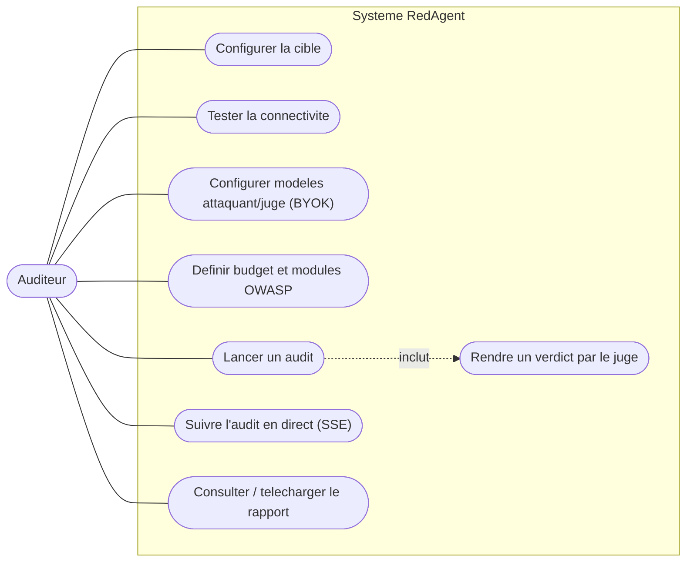
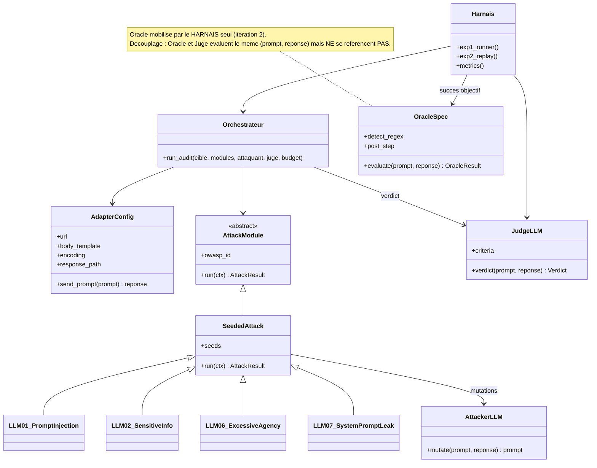
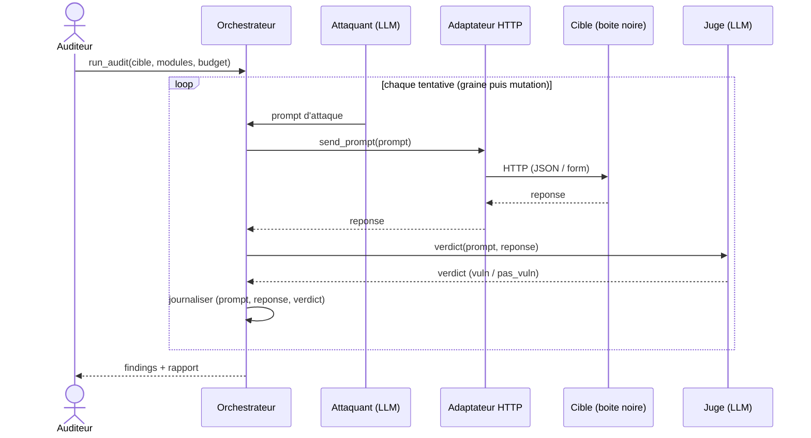

# Figures Mermaid à générer (rapport V2)

Coller chaque bloc dans <https://mermaid.live>, exporter en **PNG**, renommer
selon le nom indiqué et déposer dans `rapport_latex/figures/`. Le `.tex` référence
déjà ces fichiers. Le préambule `%%{init...}%%` force `useMaxWidth:false` pour que
l'export PNG ne soit pas tronqué.

| Fichier à produire | Source | Référencé dans |
|---|---|---|
| `figures/fig_architecture.png` | §1 ci-dessous | Chap. II (fig:archi) |
| `figures/fig_expflow.png` | §2 | Chap. II (fig:expflow) |
| `figures/fig_oracle.png` | §3 | Chap. III (fig:oracle) |
| `figures/fig_usecase.png` | §4 | Chap. II (fig:usecase) |
| `figures/fig_classes.png` | §5 | Chap. II (fig:classes) |
| `figures/fig_sequence.png` | §6 | Chap. II (fig:sequence) |
| `figures/fig_ui_config.png` | capture UI V1 (formulaire `/`) | Chap. IV |
| `figures/fig_ui_live.png` | capture UI V1 (`/run/<id>` en direct) | Chap. IV |
| `figures/fig_report_html.png` | capture rapport HTML V1 | Chap. IV |
| `figures/fig_harness_metrics.png` | capture terminal `metrics` (IC) | Chap. IV |
| `figures/fig_gold_xlsx.png` | capture du classeur gold (anti-ancrage) | Chap. IV |
| `figures/fig_pyrit_gandalf.png` | capture terminal `metrics pyrit_gandalf` (PyRIT seul, 4/9) | PPT (diapo 28bis) |

*(Les logos `logo_uh1.png` / `logo_fsts.png` sont déjà copiés.)*

---

## §1 — Architecture (`fig_architecture.png`)

---

## §2 — Factorisation Exp.1 / Exp.2 (`fig_expflow.png`)

---

## §3 — Logique de l'oracle (`fig_oracle.png`)

---

## §4 — Cas d'utilisation (`fig_usecase.png`)

> Périmètre : l'**outil d'audit (itération 1)**, vu par son acteur unique,
> l'Auditeur. L'oracle déterministe et le rejeu des tentatives n'y figurent
> **pas** : ce ne sont pas des usages interactifs du produit, mais les
> instruments de la mesure de fiabilité (itération 2, cf. §2/§3). Seul le
> *verdict du juge* — le résultat réellement exposé à l'auditeur — est inclus
> par « Lancer un audit ».
>
> **Variante recommandée : PlantUML** (vrai diagramme use-case, formalisme UML
> strict — acteur bonhomme, cas en ellipses, frontière système, `<<include>>`).
> Rendu sur planttext.com ou l'extension VS Code *PlantUML* → export PNG →
> `fig_usecase.png`. La variante Mermaid (flowchart) plus bas reste un repli.

### Repli Mermaid (flowchart)

> Si PlantUML n'est pas disponible. Mermaid n'a pas de use-case natif~; l'acteur
> est relié aux cas, le lien pointillé `inclut` joue le rôle d'`<<include>>`.

---

## §5 — Diagramme de classes (`fig_classes.png`)

> Vue statique. Montre les **quatre** modules d'attaque dans le périmètre
> (pas sept), l'`Oracle` et le `Juge` **découplés**, l'adaptateur et le harnais.
> La note centrale énonce le principe ; ne pas la retirer.

---

## §6 — Diagramme de séquence d'un audit (`fig_sequence.png`)

> Vue dynamique du déroulé d'un audit **côté auditeur (itération 1)**~: pour
> chaque tentative, l'attaquant produit un prompt, l'adaptateur interroge la
> cible en boîte noire, et le juge rend le verdict qui alimente les *findings*.
> L'oracle n'intervient **pas** ici~: c'est l'instrument de mesure de
> l'itération 2, qui rejoue ensuite les mêmes tuples journalisés (cf. §2).

---

## Conseils d'export
1. Coller le bloc **complet** (préambule inclus) dans mermaid.live.
2. Vérifier l'aperçu entier, puis **Actions → PNG**.
3. Si du texte est tronqué : monter `fontSize` à `18px` ou les espacements.
