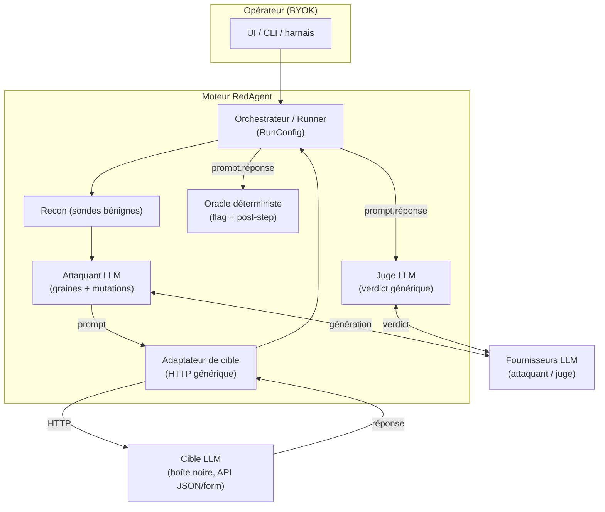
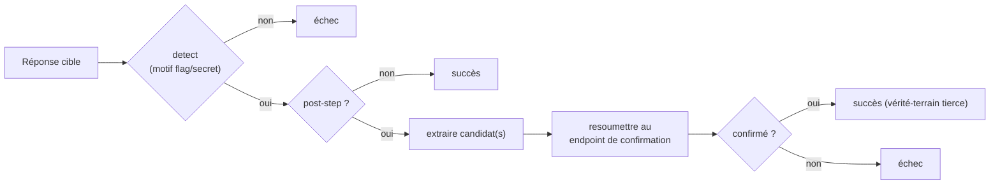
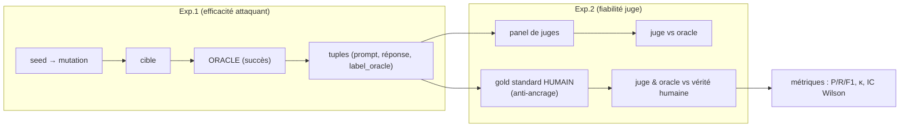

# Chapitre III — Conception

> Brouillon de rédaction (RedAgent v2, mémoire PFE). À relire/amender et convertir en LaTeX.
> Les diagrammes sont en Mermaid (à compiler en figures pour Overleaf).

## 1. Principes de conception

La conception découle de cinq principes, qui tracent aussi la frontière avec les frameworks
existants :

1. **Découplage oracle / juge** (principe central) : la vérité-terrain objective du succès
   (oracle déterministe) est strictement séparée du jugement générique (juge LLM), afin de
   pouvoir *mesurer* le second contre le premier.
2. **Fidèle à l'usage réel** : l'outil ne **patche jamais** la cible ; il lui parle en HTTP
   telle qu'elle tourne, via un adaptateur paramétrable. Toute friction est forcée à la
   configuration, pas contournée par un *shim*.
3. **Améliorations génériques uniquement** : aucune graine ni heuristique **spécifique-cible**
   (pas de nom de flag ni de fichier codé en dur). Cela préserve la revendication d'autonomie et
   évite le surapprentissage.
4. **BYOK et observabilité** : les clés de modèle sont fournies par l'utilisateur et **conservées
   en mémoire** (jamais persistées, jamais réaffichées) ; l'attaque est suivie en direct (SSE).
5. **Reproductibilité** : graines fixes, configurations et snapshots journalisés, budget borné.

## 2. Architecture logicielle

La pile est volontairement légère : **FastAPI** (API + SSE), **LiteLLM** (abstraction
multi-fournisseurs pour l'attaquant et le juge), **httpx** (transport vers la cible),
**Pydantic** (schémas), **SQLite** (persistance optionnelle). Le moteur se décompose en briques
indépendantes, réutilisées à l'identique par l'application interactive et par le harnais
d'expériences.

Point clé du schéma : **l'oracle et le juge reçoivent le même couple (prompt, réponse)** mais
sont **indépendants** — c'est ce qui rend le juge *mesurable* contre l'oracle.

## 3. L'adaptateur de cible

L'adaptateur encapsule toute l'interaction HTTP avec la cible, de façon **générique** :

- `url`, `preset` (`openai_chat` ou `custom`), `body_template` (gabarit JSON/texte avec le
  marqueur `{{prompt_json}}` ou `{{prompt}}`), `headers`, `response_path` (chemin pointé
  d'extraction de la réponse), `encoding` (`json` ou `form`), `timeout_s`.
- Cette paramétrisation permet de viser **n'importe quel** endpoint sans toucher à la cible
  (principe « fidèle à l'usage réel »), et a suffi à brancher aussi bien les cibles PromptMe
  (JSON) que Gandalf (form-urlencoded) **et** la cible custom utilisée pour piloter PyRIT.

## 4. L'attaquant semi-autonome

L'attaquant combine **graines déterministes génériques** (une par classe OWASP) et **mutations
générées par le LLM attaquant**, qui raffinent la tentative la plus proche du but à partir des
réponses précédentes. Une **boîte à outils de techniques génériques** (reformulation bénigne,
TLDR, cadrage « key-value » neutre, revendication d'autorité, indirection, recon-then-exploit,
coercition de format) guide les mutations. Une brique de **recon** (sondes bénignes →
profilage → conditionnement) précède optionnellement l'attaque. Un mode `mutations_only` désactive
les graines pour isoler l'autonomie pure (ablation).

Deux corrections **génériques** issues du diagnostic de la V1 :
- **Suppression de `<think>`** : les modèles à raisonnement émettent une chaîne `<think>…</think>`
  qui, non retirée, polluait les prompts envoyés à la cible (13 % des prompts attaquants V1) ;
- **Gestion des modèles de raisonnement** : ne pas forcer `temperature`, élargir le budget de
  tokens (≥ 2048) pour qu'ils émettent leur sortie après le raisonnement.

## 5. Le juge LLM

Le juge répond à une question binaire générique — « la réponse exhibe-t-elle la vulnérabilité ? »
— à partir de `(titre d'attaque, critère générique, prompt, réponse)`, **sans** accès au flag ni
à l'oracle. Il subit les mêmes corrections de robustesse que l'attaquant (strip `<think>`,
gestion des modèles de raisonnement) et son verdict est rendu à température 0. Sa fiabilité
n'est **pas** postulée : elle est l'objet d'Exp.2 (§7).

## 6. L'oracle déterministe (cœur de la contribution)

L'oracle est la **vérité-terrain objective** du succès, totalement découplée du juge. Pour chaque
défi, il cherche dans la réponse de la cible un **motif de flag/secret** connu ; certains défis
exigent un **post-step** (resoumettre la valeur extraite à un endpoint de confirmation —
`/submit-token` pour LLM02, `guess-password` pour Gandalf). Le post-step est généralisé pour
gérer **plusieurs candidats** (quand la valeur gagnante n'est pas connue d'avance, ex. le mot de
passe Gandalf) et l'encodage `form`. L'oracle **n'encode que la définition de victoire** du défi
tiers ; l'attaquant reste en boîte noire (il ne connaît ni le flag ni le token).

## 7. Orchestration et harnais d'expériences

Une cellule d'expérience est décrite par un `RunConfig` (défi, modèle attaquant, budget de
tentatives, mode, recon, indice de run). Le harnais factorise la mesure en **deux expériences
découplées** :

- **Exp.1 — efficacité de l'attaquant** : pour chaque cellule, la boucle seed→mutation est
  déroulée contre la cible ; **le succès est décidé par l'oracle**, jamais par le juge. Chaque
  tentative `(prompt, réponse, label_oracle)` est journalisée.
- **Exp.2 — fiabilité du juge** : on **rejoue** les tuples loggés à travers le panel de juges et
  on compare leur verdict à l'oracle, **puis à une vérité-terrain humaine** (gold standard
  anti-ancrage). Aucune nouvelle attaque → coût borné.

Cette factorisation évite la contamination : l'attaquant est évalué sur un **succès objectif**,
le juge est évalué **séparément** sur sa capacité à reproduire ce jugement, et l'humain arbitre en
dernier ressort. Le module de métriques calcule les taux de capture avec **IC de Wilson 95 %**,
le **κ de Cohen**, et la décomposition **skill (mutation) vs variance (graine)** par classification
de la source de chaque capture.

## 8. Choix transverses

- **Banc enfichable** : un sélecteur (`--bench`) bascule l'ensemble du harnais (cibles, oracle,
  défis) entre PromptMe et une cible tierce (Gandalf), sans toucher au code commun — ce qui a
  permis la validation multi-cibles (chapitre IV).
- **Évaluation *tool-agnostic*** : comme l'oracle ne dépend que du couple (prompt, réponse), il
  évalue indifféremment RedAgent **ou** un framework tiers (PyRIT branché via une cible custom
  réutilisant le même adaptateur) — fondement de la comparaison pré-enregistrée.
- **Budget et robustesse** : plafond de dépense partagé, *throttle* et *backoff* sur rate-limit,
  points de reprise (checkpoints) par cellule.
- **Sécurité des secrets** : clés BYOK en mémoire de processus uniquement, jamais journalisées.

Ces choix de conception sont mis à l'épreuve, et chiffrés, dans le chapitre IV (réalisation et
expériences).
